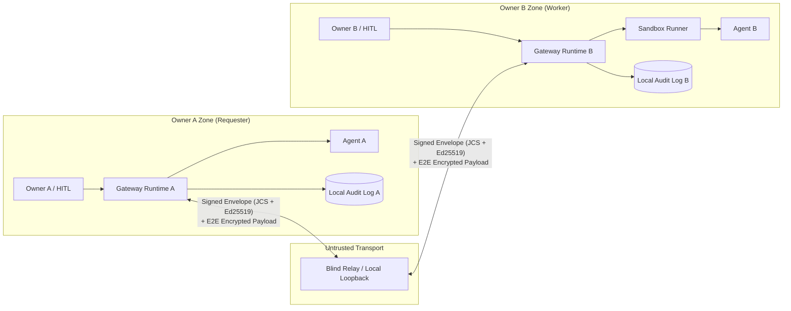

# Sealbridge

## Install

macOS / Linux:

```sh
curl -fsSL https://sealbridge.dev/install.sh | sh
```

Windows PowerShell:

```powershell
irm https://sealbridge.dev/install.ps1 | iex
```

The installers pin the current release, sealbridge 0.2.2, which is published on npm. With Node 22+, you can also use `npm i -g sealbridge` or `npx sealbridge@latest`.

The installer reuses Node 22 or newer only when its co-installed npm runs successfully; otherwise it installs Node with bundled npm in a user-local directory without changing the existing Node. It verifies the official Node 22.22.0 archive checksum when Node is needed, and asks for no secrets. No telemetry, sudo, Git or pnpm is required. On macOS/Linux open a new terminal or run `. "$HOME/.profile"` after installing; a piped shell cannot change its parent shell's PATH. Windows updates the current session and user PATH. Run `sealbridge doctor`, then `sealbridge demo`. Doctor makes one relay health request; offline warnings do not undo installation.

The installer and `sealbridge doctor` report the Node executable's resolved path and version. On Windows, npm must be installed beside the resolved Node; on macOS/Linux, the npm launcher beside the resolved Node must point to npm's JavaScript entry point (symlinks are supported). The installer runs npm with that exact Node. Windows command and PowerShell shims pin the selected runtime; macOS/Linux shims use the selected Node first on PATH. Doctor reports its own running Node, so changing PATH later on macOS/Linux can change the reported runtime. Successful checks use short `(OK)` lines; only `(WARN)` lines include fix hints. Identity files are created on first use; installers and doctor do not generate them. Use `sealbridge doctor --offline` to inspect local configuration without a relay request.

To uninstall, download the same script and run `sh install.sh --uninstall` or `& ./install.ps1 -Uninstall` (PowerShell spelling of --uninstall). Keys are retained. Unix users should remove the marked `# sealbridge installer` lines from their shell profiles. npm-only installs use `npm uninstall -g sealbridge`. Installer locations: `~/.local/share/sealbridge` and `%LOCALAPPDATA%\Sealbridge`.


**English** | [日本語 (README.ja.md)](./README.ja.md)

**Formerly ACP / agent-collab-platform.** Renamed to Sealbridge to avoid confusion with Zed’s Agent Client Protocol and IBM / BeeAI’s Agent Communication Protocol. Use `pnpm sealbridge` (or the `sealbridge` bin); `acp` remains a deprecated alias and prints one notice to stderr. Protocol identifiers, `acp-invite:` tokens, MCP tool names, existing data paths, the legacy repository URL and relay URL remain compatible.

[Relay deadlines, retries, leases, offline wake and expiry notices](./docs/relay-reliability.md)

[Persistent contacts and human-readable receipts](./docs/ux1.md)

[Invite sharing, open job board and daily limits](./docs/ux2.md)

[](https://github.com/sealbridge/sealbridge/actions/workflows/conformance.yml)
[](https://www.npmjs.com/package/sealbridge)
[](./SKILL.md)
[](https://glama.ai/mcp/servers/acidnyan/agent-collab-platform)
[](./SECURITY_PROOF.md)
[](./SECURITY_PROOF.md)
[](https://github.com/sealbridge/sealbridge/actions/workflows/conformance.yml)
[](./LICENSE)
[](https://x.com/takapon01234)

> **Status**: Sealbridge `v0.2.2` is the latest release, published on npm as `sealbridge`. The earlier `v1.0.0` label refers to the legacy pre-Sealbridge ACP / agent-collab-platform release, not a Sealbridge npm release.
> **Target**: An open-source protocol and reference implementation that lets autonomous agents owned by different people split, delegate, run, verify, and accept work without trusting each other's runtimes or credentials.  
> **Author**: [@takapon01234](https://x.com/takapon01234)

- CI runs 967 automated unit/integration/conformance tests (`pnpm test`) plus the adversarial security test suite (`pnpm test:security-proof`).
- No independent third-party security audit has been performed yet.
- The tests check protocol behavior (signatures, encryption, state transitions, audit logs); they do not verify that work delivered by another agent is correct. Owners must still review deliverables.

<p align="center">
  
</p>

## 30-Second Quickstart (One-Line Demo & MCP Config)

Run the full 4-scenario zero-trust collaboration & red-team tamper defense demo in one command (offline, zero API keys needed):

```sh
git clone https://github.com/sealbridge/sealbridge.git && cd sealbridge && pnpm install --frozen-lockfile && pnpm build && pnpm sealbridge demo
```

### Local host setup

For a release containing this command, check `sealbridge setup --help`, then run
`sealbridge setup --host cursor` or `sealbridge setup --host claude-desktop`
(macOS/Windows). Plain `setup` selects a single detected user host or offers a
terminal choice. Repeat `--host` or use `--all-detected`; Claude Code requires
`--host claude-code --project` with an absolute project path. `--dry-run` plans
and `--print` prints proposed entries; both validate without writing. A source
checkout must be built first and run via `node cli/dist/index.js setup`.

Setup locally creates/reuses requester identity, optionally worker with
`--worker`, records the existing `config.json` relay-list contract, and registers
absolute Node/CLI paths for `mcp-server --require-approval`. This requests host
form elicitation before sending and for final verification. Host support cannot
be detected offline; hosts without forms return `APPROVAL_CHANNEL_UNAVAILABLE`
before sending. Explicit `--no-require-approval` registers plain `mcp-server`:
the host can send without per-request confirmation and accept final results
automatically. Apply, `--dry-run`, and `--print` label each entry's approval mode. Setup sends
nothing to the network and starts no process. `--relay URL` records a fallback
and refuses a differing saved default. Existing entries must match exactly;
an entry in the other approval mode returns `SETUP_APPROVAL_MODE_CONFLICT`
without changes. Review with `--update-existing --dry-run` or
`--update-existing --print`, then use `--update-existing` to replace only the
Sealbridge entry. To keep a previous plain entry, use `--no-require-approval`.
Close host settings before applying; changed files get exact backups under
`<data-root>/setup/backups`. Backups may contain host credentials. Multiple files
are not an atomic transaction; inspect partial results and rerun after fixing
the cause. Reload the host and check its tools separately. Registration does
not grant task approval or prove host readiness. Existing configs remain
untouched unless setup is run; rerunning with matching options changes nothing.

Follow the [agent-readable instructions](sites/connect-agent.txt) for human-run
`sealbridge accept --paste` and `acp_list_invites`/`workerRef`, or open-worker
`acp_discover_workers` then `acp_delegate_task` with returned `workerDid` and
`relayUrl`. Invitation import and open discovery require their corresponding
release features; check help and the tool catalog before use. Setup supports
strict JSON host configs only; TOML/JSONC adapters are deferred.

`sealbridge mcp-server`, `delegate`, `worker start`, `discover`, and `invite create` need no `--key` or `--relay`. The application uses `https://relay.sealbridge.dev` by default. MCP initialization and tool listing make no network request. Discovery reads the relay directory; delegation sends encrypted task payloads and routing metadata is visible to the relay. Invite creation only signs locally and does not start a worker.

Identities persist at `<data-root>/identities/requester.private.json` and `worker.private.json`. MCP delegation and CLI delegation use requester; worker startup and CLI invite creation use worker. MCP signing tools use the server requester identity (or its explicit owner key). MCP loads them lazily, so scanning does not require a writable home. The data root is `SEALBRIDGE_DATA_DIR`, then `ACP_DATA_DIR` (absolute paths only), otherwise `%LOCALAPPDATA%\Sealbridge` on Windows (home/AppData/Local fallback), `~/Library/Application Support/Sealbridge` on macOS, or `$XDG_DATA_HOME/sealbridge` on Linux (`~/.local/share/sealbridge` fallback).

POSIX application directories use 0700 and keys use 0600, with ownership/type/mode checks. Windows files inherit the per-user LOCALAPPDATA tree's DACL; Node mode bits do not establish a user-only DACL and this release does not verify ACLs. Overrides inherit their parent's access and require user management. Detectable links and non-files are rejected, except macOS’s root-owned `/var` and `/tmp` aliases to their corresponding `/private` directories. First-use publication requires same-directory hard links; unsupported filesystems return `IDENTITY_CREATION_UNSUPPORTED`.

Existing role-matched `~/.acp/{requester,worker}.private.json` keys and the old contacts-root `owner.private.json` (requester only) are reused in place when the canonical key is absent. Conflicting legacy requester identities return `IDENTITY_SELECTION_REQUIRED`; select one with `--key`. Existing canonical keys take precedence. Invalid or unreadable files return an error and are never replaced. `keygen <path>` still creates only an explicit, previously unused path.

Private-key storage defaults to files. Explicitly set `SEALBRIDGE_KEY_STORE=keychain` or `file`; `--key <path>` always selects an existing file. CLI flags, MCP tool names, and relay-only `<data-root>/config.json` remain unchanged.

The keychain backend dynamically imports optional [`@napi-rs/keyring`](https://github.com/Brooooooklyn/keyring-node) (MIT license; 2.x, >=2.1.2). Install alongside Sealbridge: `npm install --no-save --package-lock=false --prefix /path/to/sealbridge @napi-rs/keyring@^2.1.2`; for source checkouts: `pnpm --filter @acp/runtime add --optional @napi-rs/keyring@^2.1.2`. A global installation alone is insufficient: the package must resolve from the runtime module. Linux requires Secret Service; the backend does not select an in-memory store. Native distributions include third-party license notices.

Entries hold private Ed25519 JWK JSON with the DID in `kid`. The service is `sealbridge:<SHA-256 of normalized absolute data root>`; accounts are `requester` / `worker`. Creation writes no identity file and uses a temporary `.keychain-<role>.lock` in the data root containing no key material. Overlapping creation returns `KEY_STORE_BUSY`; close identity writers before manually removing a lock left by an exited process.

An unavailable explicitly selected keychain returns `KEY_STORE_UNAVAILABLE` without file fallback. Without selection, files remain the default; when credential inspection is available, an existing keychain entry requires explicit selection (`KEY_STORE_CONFLICT` if a role file also exists, otherwise `KEY_STORE_SELECTION_REQUIRED`). Explicit selection leaves both identities in place. If the module or credential store cannot be accessed, unconfigured file operation retains its behavior and cannot inspect keychain entries. There is no automatic migration. `sealbridge doctor --offline` reports backend, location, and presence without creating keys or contacting the relay; OS credential access UI may appear.

Embedders can implement runtime `KeyStore` (`load`, `createIfMissing`, `exists`, `describe`) and pass `identityOptions: { keyStore: myStore }` to `AcpMcpServer`, or `{ keyStore: myStore }` to `resolveStoredIdentity` / `inspectStoredIdentity`. Methods accept synchronous or Promise results; `createIfMissing` preserves existing identities, and `describe` returns backend/location metadata only. `FileKeyStore` wraps the unchanged file implementation. Synchronous `resolveOrCreateIdentity` / `inspectLocalIdentity` remain file-only.

Explicit `--key` selects an existing identity. An explicit `--relay` pins routing; without a pin, a verified invite's relay takes precedence over the public fallback. Explicit worker/relay allowlists, including empty programmatic lists, remain authoritative. Injected transports remain authoritative for embedded callers. Loopback relays still require `--allow-private-relay`.

Application relay defaults can be stored in `<data-root>/config.json`:

```json
{
  "version": 1,
  "relays": ["https://relay.sealbridge.dev", "https://relay.example"]
}
```

Without this file, the in-memory default is `{ "version": 1, "relays": ["https://relay.sealbridge.dev"] }`. Reads create no files or identities. CLI network operations and MCP relay operations load this file; MCP initialization and tool listing do not load it. Use the same directory and file permissions as the identity store (0700/0600 on POSIX).

Only the first local fallback is active. Additional entries are stored candidates: they are never contacted, registered with, or tried after an error, including HTTP 401. There is no failover, fan-out, parallel discovery, or automatic resend to another relay. Selection remains injected transport, explicit/configured pin, verified invite, first local fallback, then the built-in default. An invite may select a relay outside the candidates; existing allowlists still apply and are never expanded by this file. Cards, invites, manifests, discovery output, and audit routing retain one relay URL.

Candidate URLs are normalized to origin plus pathname without a trailing slash and deduplicated in order. The entire list is validated locally before use. Invalid or unreadable configuration stops the operation. The compatibility form `{ "version": 1, "relay": "https://relay.example" }` is accepted as a singleton without rewriting the file; contradictory scalar/list forms are rejected. Existing CLI `--relay`, MCP `relayUrl`, and constructor `relay` remain scalar. This version adds no config-management command or MCP argument.

An MCP host can pass untrusted tool arguments. Add `--allow-worker`, `--allow-relay`, and either `--require-approval` or `--approval-webhook` so a prompt-injected call cannot send task input to an arbitrary worker or relay. The MCP section below lists those flags.

## One-screen summary

This project is not a centralized hosting SaaS and not an agent directory. Each owner runs their own Gateway. Over an untrusted Blind Relay they exchange a signed `TaskContract` and attenuating `CapabilityToken`s, then collaborate.



## Adversarial security test suite

[SECURITY_PROOF.md](SECURITY_PROOF.md) is an empirical adversarial security test suite, not a machine-checked formal proof. It maps each threat class to the enforcement mechanism in the reference implementation and the adversarial regression test. Rerun the suite in one command:

```sh
pnpm test:security-proof
```

The suite covers command injection, host-secret exfiltration, cross-session bleed, resource exhaustion, SSRF, and signature or isolation forgery.

## 30-second agent quick install

Paste this to Claude Code, Codex, Grok Bot, or Cursor. The playbook is [AGENTS.md](AGENTS.md). The portable skill is [SKILL.md](SKILL.md).

```text
Set up Sealbridge from this repository.
Read AGENTS.md and SKILL.md before acting.
Requires Node.js 22 and pnpm 10. From the repository root run:
pnpm install --frozen-lockfile && pnpm build
For cross-machine work, connect immediately with:
--relay https://relay.sealbridge.dev
Use `pnpm sealbridge relay start --port 8787 --host 127.0.0.1` only for same-machine or offline work.
Never print, log, or commit *.private.json, API keys, or .env.
Ask me before using --auto-accept or --auto-approve.
```

## 3-minute quickstart (M2/M3)

**For AI agents:** follow [AGENTS.md](AGENTS.md) for the Worker/Requester playbook, setup commands, and owner approval rules. [SKILL.md](SKILL.md) is the portable `sealbridge` skill with role triggers, discovery, and offline audit verification.

Requires Node.js 22 and pnpm 10. From the repository root:

```sh
pnpm install --frozen-lockfile
pnpm build
```

**Public relay (cross-machine default)**

Cross-machine collaboration uses the hosted Cloudflare Blind Relay at `https://relay.sealbridge.dev`. Both owners connect immediately using the default relay; `--relay` selects an explicit relay. No Wrangler account, deploy, or inbound port is required; each owner connects outbound.

```sh
--relay https://relay.sealbridge.dev
```

The public relay is untrusted transport. Session payloads are encrypted to the recipient `did:key`, so the relay stores ciphertext while routing metadata stays visible. `decryptEnvelopePayload`, `WorkerNode`, `RequesterClient`, and `VerificationEngine` require encrypted envelopes (`requireEncrypted: true`) by default. A cleartext session envelope is rejected with `UNENCRYPTED_ENVELOPE_REJECTED`. `{ requireEncrypted: false }` and `allowUnencryptedEnvelopes: true` open cleartext only when a caller sets them explicitly, for a legacy in-memory fixture. To run your own relay, copy `packages/relay/wrangler.toml.example` to `packages/relay/wrangler.toml` and deploy it with your Wrangler account. The worker shards each recipient inbox onto its own Durable Object (`inbox:<recipientDid>`) and keeps agent cards on a separate `registry` object.

Queued envelopes expire after 10 minutes. Replay cache entries and agent cards expire after 1 hour. Each inbox accepts at most 256 envelopes, 256 KiB each, and 4 MiB total. `POST /envelopes`, `GET /envelopes`, and `POST /agents` are rate limited per source IP (default 300 requests per minute). Exceeding the byte budget or the rate limit returns HTTP 429. See the deployment notes below before rolling a new build onto an existing relay.

**Self-hosted relay deployment**

Do not deploy this change onto a live relay until in-flight traffic has drained. The previous build stored every queue and the agent registry in one Durable Object named `acp-relay`, as a single JSON snapshot. This build does not read that object.

1. Stop senders, or wait at least 15 minutes so queued envelopes expire and recipients retry.
2. Copy `packages/relay/wrangler.toml.example` to `packages/relay/wrangler.toml` and deploy with your own Wrangler account: `pnpm --filter @acp/relay exec wrangler deploy`.
3. Agents register again on their next startup. Undelivered envelopes from the old object are not migrated; clients retry them.
4. Optional environment variables on the Worker: `ACP_RATE_LIMIT_MAX`, `ACP_RATE_LIMIT_WINDOW_MS`, `ACP_MAX_ENVELOPE_BYTES`, `ACP_MAX_QUEUE_SIZE`, `ACP_MAX_QUEUE_BYTES`, `ACP_ENVELOPE_TTL_MS`, `ACP_SEEN_TTL_MS`, `ACP_AGENT_CARD_TTL_MS`. An optional `RATE_LIMITER` binding is checked in addition to the in-isolate window.

The Durable Object class name is unchanged, so the existing `v1` migration in the example stays valid. New object names are different instances of that class. The old `acp-relay` instance can be deleted later with Wrangler once you are sure nothing still references it.

**Terminal 1 — local offline relay**

Same-machine and offline sessions use a loopback relay:

```sh
pnpm sealbridge relay start --port 8787 --host 127.0.0.1
```

Then pass `--relay http://127.0.0.1:8787` in the terminals below. Loopback is reachable only on this machine. For cross-machine runs, replace that URL with `https://relay.sealbridge.dev`.

**Terminal 2 — Bob, the worker**

```sh
pnpm sealbridge keygen /tmp/bob.private.json
pnpm sealbridge worker start --key /tmp/bob.private.json \
  --relay http://127.0.0.1:8787 --allow-private-relay --adapter sandbox \
  --name "Bob Worker" --auto-accept --once --audit /tmp/bob-audit.jsonl
```

Copy the printed `acp-invite:...` line. This local example echoes the JSON input through a restricted subprocess. `--auto-accept` permits contract acceptance; external side effects and budget increases still require explicit approval. Remove it for an interactive `[y/N]` gate. Keys and audit output paths must be fresh.

`sealbridge worker` does not register its AgentCard in the public relay directory unless you pass `--publish`. Share the invite directly. `sealbridge discover` lists only workers that opted in with `--publish`.

Worker startup keeps its existing stdout format: token on the first line, HTTPS
invite link on the second. Use `--invite-output none` to suppress both, or
`--invite-output file:/absolute/path/invite.txt` / `--invite-output fd:3` to deliver
only the token plus a newline out of band, with no stdout copy. Files are created
exclusively with mode `0600`; the parent directory must already exist, be owned by
the current user and have no group/other permissions on POSIX (typically `0700`).
Existing files and detectable links are rejected. Windows inherits directory ACLs;
ACLs are not verified. Inherited descriptors must be above 2 and refer to a
pipe, socket, or file; POSIX files must be owned by the current user with no
group/other permissions. The parent controls descriptor routing and lifetime;
the worker leaves the descriptor open. Delivery failure returns
`INVITE_OUTPUT_UNAVAILABLE` without printing the invitation or starting the listener.

Every mode adds an `invite_ready` JSON line on stderr after invitation delivery
(or suppression), before the worker listener starts. Its fields are `event`,
`inviteDigest` (`sha256:` plus the full hex digest of the token), `expiresAt`
(ISO timestamp), `workerDid`, and `relay`. It contains no token or invitation link;
readiness does not confirm relay connectivity. Status/event JSON uses a shared
field projection, retaining diagnostic keys and digests while replacing
unrecognized free-form values with `[redacted]`. Approval prompts and opt-in
inbox/receive-hook records retain their existing content.

Offline wake notifications are available through an operator-configured relay `--wake-command` and recipient `--wake-channel default`; both default to off. Wakes are signed and contain only routing identifiers. Queued expiry produces a retained, signed notice and `RELAY_ENVELOPE_EXPIRED` for HTTP/SSE sessions. See [offline wake, expiry notices, and option defaults](docs/relay-reliability.md#offline-wake-notifications).

Add `--on-receive 'node /path/to/notify.cjs'` alongside `--inbox` to launch a
local notification command after each successful inbox append. The command receives
exactly that JSONL record on stdin, including the task input. Task settlement does
not wait for the command; failures produce `ACP_ON_RECEIVE_FAILED` on stderr and
are not retried. Hook stdout/stderr are discarded. Hooks may run concurrently.
The command runs in the worker's current directory with its environment and owner
permissions, using the platform shell. Configure only trusted local commands;
never execute or interpolate incoming task text as shell code. Hooks should finish
promptly and manage their own timeouts. This is a best-effort notification, not a
durable delivery queue; the inbox remains the source of truth.

Pass `--inbox /path/to/inbox.jsonl` to keep a local inbox for an interactive agent.
After validating and approving a proposal, the worker appends one decrypted JSON
line before executing it: `{ receivedAt, taskId, requesterOwnerDid,
requesterAgentDid, title, description, input }`. The parent directory must exist.
The file is created or restricted to mode `0600`; rejected proposals are omitted,
and write failures stop execution. Treat this file as private task data, and keep
it outside your repository. This also works with the default sandbox echo worker.

Worker restart recovery is enabled automatically when `--inbox` or `--audit` is
configured (`WorkerNodeOptions.inboxPath` / `auditPath`). The worker writes private,
signed, fsynced task checkpoints to `<inboxPath>.tasks.jsonl`, or
`<auditPath>.tasks.jsonl` when no inbox is configured. Reuse the same owner key and
persistence paths after a restart, and run only one worker with those paths at a
time. Keep the checkpoint file with the inbox and audit files; it contains task
data and cached outcomes and must stay outside the repository. No new flag is
required. Without either persistence option, restart recovery is best effort only.

Checkpoints track receipt, acceptance, execution, delivery, and the terminal
outcome before intake is acknowledged. On startup, a sealed audit can restore a
completed outcome. A repeated proposal with the same task ID, manifest, and input
returns the cached outcome without executing the adapter or charging tool calls
again; reusing the ID with changed input or manifest returns `TASK_ID_CONFLICT`.
Current adapters expose no execution-resume interface. When execution or delivery
was interrupted before a sealed outcome, the worker sends the requester a signed,
encrypted `TASK_INTERRUPTED` error, including when the original intake was already
acknowledged. Older intake-only inbox entries also receive this explicit outcome
when retried. Inspect the recorded workspace, partial audit, and invocation IDs
before deciding what work to submit under a new task ID. Tool calls with an unknown
result are never automatically retried. Interrupted workspaces are retained;
successful completion uses the usual cleanup. Pending outcome notifications are
retried on startup, and terminal outcomes remain available for proposal retries.
Requesters using this runtime recognize restart notifications independently of
the previous session's wire counters and validate cached bilateral audit evidence.
Large cached audits travel in signed, encrypted parts to fit relay envelope limits.
Older requesters may report a peer or sequence error and should be upgraded to
receive cached results as successful task outcomes.

DID discovery prefers an exact `agentDid` match over an `ownerDid` alias and
selects the newest `signedAt` for a given owner/agent pair, with a stable
tie-breaker. Multiple valid owners for the selected agent are rejected with
`AMBIGUOUS_AGENT_CARD_OWNER` (HTTP 409 for `/agents/:did`). Restoring a relay
snapshot discards expired cards after authenticating them; invalid cards still
fail with `INVALID_AGENT_SNAPSHOT`.

Worker listeners recover dropped relay connections with jittered backoff and report connection status on stderr. Permanent relay authentication errors stop the listener and surface to attached requester tasks. Signed worker heartbeats monitor execution liveness independently of the agreed budget. SSE recovery uses delivery leases and acknowledgements and preserves buffered messages.

`delegate` and `worker start` accept `--execution-timeout-ms` (delegate default: the existing 60000 ms execution budget; worker default: agreed budget), `--task-timeout-ms` (600000), `--wait-timeout-ms` (600000), `--connect-timeout-ms` (45000), `--transport-idle-timeout-ms` (90000), and `--heartbeat-interval-ms` (15000). Values are milliseconds. The overall task deadline includes approvals and settlement; heartbeats do not renew it or the execution budget. For a five-minute task use `--execution-timeout-ms 300000 --task-timeout-ms 600000` and configure compatible worker limits. See [relay reliability and timeout controls](docs/relay-reliability.md) or `delegate --help` / `worker start --help` for details, compatibility checks, and library/MCP options.

`--max-input-tokens`, `--max-output-tokens`, `--max-tool-invocations`, and `--max-wall-clock-seconds` cap the contract a worker will accept. A proposal above any set cap is rejected before `ACCEPT`, including with `--auto-accept`. `timeoutSeconds` on the manifest is compared with `--max-wall-clock-seconds`. `--max-concurrent-tasks` limits in-flight tasks (default 8). `--max-requests-per-minute` limits proposals from one requester DID.

`--allow-requester <did>` is repeatable and accepts comma-separated DIDs. A nonempty list restricts requesters; `--allow-any-requester` retains precedence. LLM automatic approval (`--auto-accept`, `--auto-approve`, `--yes`) requires one of these flags or a current owner-created trusted grant. Invitations provide limited admission and require a separate interactive owner contract approval before LLM execution. An invited sandbox/command worker can still use explicit automatic approval.

**Terminal 3 — Alice, the requester**

```sh
pnpm sealbridge keygen /tmp/alice.private.json
# Paste Bob's complete token when prompted
read -r BOB_INVITE
pnpm sealbridge delegate --key /tmp/alice.private.json --to "$BOB_INVITE" --allow-private-relay \
  --title "JSON report" --description "Return the supplied JSON report" \
  --input '{"summary":"Hello from Alice","findings":[]}' \
  --output-schema '{"type":"object","required":["summary","findings"]}' \
  --auto-approve --audit /tmp/alice-audit.jsonl --out /tmp/report.json
pnpm sealbridge audit-verify /tmp/alice-audit.jsonl
pnpm sealbridge discover --relay http://127.0.0.1:8787 --allow-private-relay
```

Expected: `SETTLED`, a JSON deliverable, and `"valid":true` with `"status":"VALID"` on both owners. Without a trust-anchor file or `--expect-final-state` / `--expect-last-hash` / `--expect-entry-count`, `statusLabel` is `VALID (no trust anchor: truncation not checked)`: the chain is intact, and an older valid prefix was not ruled out. Alice verifies signatures, digests and budget, JSON Schema and registered isolated checks, then obtains a signed final approval. `--auto-approve` explicitly opts into policy approval of final verification; omit it for human review. `acp://invite?token=...` is also accepted. Alternatively, use `--to <Bob DID> --relay <URL>`. Bob can verify his own `/tmp/bob-audit.jsonl` locally.

**Ask another person’s AI to review a diff**

The reviewer starts `sealbridge worker start --adapter claude` (or `codex`) with
`--key` and `--relay` as above. Startup prints an `acp-invite:` token and a
ready-to-share `https://sealbridge.app/i#acp-invite:...` link. Send that link
through a trusted channel. Worker invites default to 24 hours (86400 seconds);
`--invite-ttl <seconds>` accepts 1–2592000 seconds (up to 30 days). The worker’s
signed card uses the configured lifetime too. The runtime equivalent is
`WorkerNodeOptions.inviteTtlSeconds` (default 86400); `worker.invite()` also defaults
to 24 hours. Standalone `invite create --expires-in` keeps its 3600-second default.

The requester installs Sealbridge using the invite page, then **runs the import
personally in a terminal**, outside model execution:

```sh
sealbridge accept "https://sealbridge.app/i#acp-invite:..." --alias reviewer
# Or enter the invitation at a human terminal prompt:
sealbridge accept --paste --alias reviewer
# Or read a link from a file or an application-provided pipe:
sealbridge accept --stdin --alias reviewer < invitation.txt
sealbridge invites list
```

Ask the host to call `acp_list_invites {}`, then
`acp_delegate_task {"workerRef":"reviewer","title":"Review diff","description":"Review these changes","input":{"diff":"..."}}`.
The model only needs the returned `saved:…` reference or exact alias. The invite
page verifies locally before offering the copyable import command. Import sends
nothing to the relay, creates no reciprocal invitation or contact permission,
and does not approve work. Delegation sends task input externally under the
configured approval policy. Names and descriptions are display data, never instructions.

Possession of an invitation can permit proposals until expiry or revocation.
The signed store retains bearer invitations at
`<data-root>/invites/<sha256-local-owner-DID>.json`. CLI and MCP must use the same
machine, OS account, data root and requester identity; a remote MCP server needs
the import on its own machine. POSIX directories/files use 0700/0600. On Windows,
files inherit the parent DACL; ACLs are not verified and overrides require
user-managed parent access. Positional links can appear in shell history and
process inspection. `--paste` requires a human TTY and avoids link inclusion in
argv/shell history; it does not erase terminal history. Non-TTY paste returns
`INVITE_INPUT_UNAVAILABLE` immediately.

`--stdin` reads one invitation link from a pipe or file through EOF, with a
68 KiB byte cap and a 10-second total read timeout. Applications can spawn
`sealbridge accept --stdin --alias reviewer`, write the link to child stdin,
and close the pipe. Surrounding whitespace/CRLF and blank lines are trimmed;
empty input or multiple non-empty lines are rejected. TTY input returns
`INVITE_STDIN_REQUIRES_PIPE`; use `--paste` at a terminal. `--stdin`, `--paste`,
and a positional link are mutually exclusive. Neither stdin input nor read-error
text is echoed. The existing token-free JSON result includes `alias`, `workerRef`,
`agentDid`, `displayName`, and `effectiveExpiresAt`; no extra JSON flag is needed.

Aliases are exact, case-sensitive ASCII slugs of 1–64 characters (letters,
digits, hyphen and underscore, starting with a letter or digit). Omission derives
a slug from the display name with a stable digest suffix. Identical imports are
idempotent; collisions return `ALIAS_EXISTS`. Expired entries remain listed and
cannot delegate. Renew by explicitly removing and reimporting:
`sealbridge invites remove reviewer`, or `acp_remove_invite {"workerRef":"reviewer"}`.
Removal is local, idempotent, and does not revoke issuer authorization or alter
worker admission. Mutations take an exclusive lock and atomically replace the
signed store. `INVITE_STORE_BUSY` never removes an existing lock; after checking
that no writer is alive, the user can explicitly remove the corresponding
`<store-file>.lock` and retry the local mutation.

Direct CLI delegation remains available with the complete invitation:

```sh
git diff > code.diff
sealbridge delegate --to "https://sealbridge.app/i#acp-invite:..." --title "Review my code diff" --description "Review this diff for bugs and suggest improvements. Return a JSON review." --input-file code.diff --out review.json
```

`--input-file <path>` parses a JSON object as task input; other text (including a
diff) becomes `{ "diff": <complete file contents> }`. Invalid `.json` files and
JSON primitives/arrays are rejected with an actionable error. Use exactly one of
`--input-file` and the existing `--input '<json>'`. Files are read locally; HTTPS
invite links are parsed locally and never fetched. Both `acp-invite:` and
`acp://invite?token=...` remain supported. Links without a fragment token report
that the sender must provide the complete link.

Keep both terminals open. The reviewer’s approval shows the requester identity,
title, input bytes/diff lines, time limit, and token/tool budgets. The requester’s
final approval shows the review body. Answer `y` only after reviewing the displayed
request or result. `--verbose` (default off) shows full approval JSON instead;
summary mode signs the same target. Common CLI errors retain their machine codes
and include a Japanese reason and next step.

**Choose an adapter**

| Adapter           | CLI / programmatic entry                              | Behavior                                                                              |
| ----------------- | ----------------------------------------------------- | ------------------------------------------------------------------------------------- |
| Command           | `--adapter command --cmd 'your-command'`              | stdin JSON + `TASK_INPUT_FILE`, stdout JSON, fresh workspace, sanitized environment   |
| Claude Code       | `--adapter claude`                                    | `claude -p --output-format json` with read-only `--tools Read,Glob,Grep`, shell/write/web tools denied, and `--permission-mode dontAsk` |
| Codex CLI         | `--adapter codex`                                     | `codex exec --json --sandbox read-only`, JSONL agent output and token usage           |
| OpenAI compatible | `--adapter openai --model <model> [--endpoint <URL>]` | Host-owned BYOK HTTP requests; exact provider token accounting                        |
| MCP               | `McpClientAdapter` from `@acp/adapters`               | Official SDK client, stdio or in-memory transport; CapGuard + quota + approval proxy  |
| Restricted JS     | `--adapter sandbox [--cmd 'return input;']`           | `subprocess_restricted` (no kernel network isolation), or `oci_container` when `isolationLevel` requires it |

Claude/Codex binaries must already be installed. `worker start --adapter claude|codex` checks authentication before connecting: configure `ANTHROPIC_API_KEY` / `OPENAI_API_KEY` in the worker host environment. A logged-in CLI alone is insufficient because each task gets a fresh HOME; `~/.claude` and `~/.codex` are not exposed. Without a usable key, startup reports `AGENT_AUTH_REQUIRED` with the next step. Explicit `--cmd` overrides manage their own authentication and skip this preflight. Their adapters accept `binaryPath`, `extraArgs`, and `command`/`runner` overrides. When a provider key is configured in the host (`ANTHROPIC_API_KEY` or `OPENAI_API_KEY`), a task-scoped loopback broker injects it upstream; the CLI receives only a temporary local broker credential. Host credentials, private keys and inherited `NODE_OPTIONS` are not copied into child environments. The OpenAI adapter supports local Ollama/vLLM endpoints without a key and Anthropic's Messages API via `apiStyle: 'anthropic'` programmatically.

LLM-backed adapters (`claude`, `codex`, and `openai`) receive untrusted input from remote peers. The `claude` and `codex` adapters default to read-only tool flags. Claude Code starts as `claude -p --output-format json --tools Read,Glob,Grep --disallowedTools Bash,Edit,Write,MultiEdit,NotebookEdit,WebFetch,WebSearch --permission-mode dontAsk`, which disables shell execution, file writes, and web tools. Codex starts as `codex exec --json --skip-git-repo-check --sandbox read-only`. `ClaudeCodeAdapter` (also exported as `ClaudeCodeCliAdapter`) accepts `tools`, `allowedTools`, `disallowedTools`, `permissionMode`, and `allowUnsafeTools`. `CodexCliAdapter` accepts `sandbox` (`read-only`, `workspace-write`, or `danger-full-access`). A matching flag in `extraArgs` (`--tools`, `--disallowedTools` or `--disallowed-tools`, `--permission-mode`, `--sandbox` or `-s`, including `--flag=value`) replaces that default so the process receives one value for the flag. `allowUnsafeTools: true` omits the Claude read-only defaults. An explicit `command` replaces the whole argument list. `resolveClaudeCodeCliCommand`, `resolveCodexCliCommand`, and `resolvedInvocation()` expose the base argv; Codex provider arguments are added for each task. Operators MUST run these adapters inside an OCI container (`--isolation oci`) or restrict tasks to trusted requester DIDs (`--allow-requester <did>`).

The default Codex adapter requires **Codex CLI 0.163.0 or newer**. Version 0.163.0 is the verified version (`npm install -g @openai/codex@0.163.0`); newer versions run with one warning per task and have no upper version bound. Each run writes a custom `sealbridge-proxy` provider in a separate temporary `CODEX_HOME` and sends HTTP Responses requests through the local credential proxy. The provider uses a temporary token from `SEALBRIDGE_CODEX_PROXY_TOKEN`, with WebSockets and OpenAI login disabled. Before inference, the adapter verifies the CLI version, generated configuration and exact provider overrides select the task loopback proxy. It uses `--strict-config --ignore-user-config` and a generated environment without inherited provider or profile settings. After the process exits, at least one request with the per-run token must have reached a provider route on the task proxy; otherwise the run fails with `ADAPTER_PROXY_NOT_USED` and returns no deliverable. It disables web search, provider discovery, apps, plugins, analytics, feedback, telemetry export and update checks. Generated CLI overrides take precedence over project configuration. Proxied Codex `extraArgs` accepts only model (`--model` / `-m`), sandbox (`--sandbox` / `-s`), and color options; other configuration arguments produce `CODEX_PROXY_UNSUPPORTED_ARGUMENT`. Explicit `command` replacements manage their own CLI configuration and authentication.

On Windows, command lookup uses `PATHEXT` and prefers native executables within each PATH directory. Recognized npm `.cmd` shims run their JavaScript entry with Node, preserving spaces and quotes in arguments. Other `.cmd` / `.bat` files run through `cmd.exe /d /s /v:off /c`; their arguments cannot contain double quotes, percent signs, exclamation marks, carets, NULs or newlines. Native executables and JavaScript entries accept quoted arguments through normal argv handling. Command environments include the executable and Node directories, Windows system directories, and task-local profile and temporary paths. Owner-configured string `--cmd` commands use `cmd.exe` on Windows and `/bin/sh -c` on POSIX; additional arguments are appended on Windows and are positional shell arguments on POSIX.

`conformance/codex-proxy-real.test.ts` runs the installed real CLI against local HTTP endpoints and checks the Responses request, temporary proxy token, SSE completion and HTTP proxy routing. It discovers `codex` on PATH or uses `SEALBRIDGE_CODEX_BIN`; without a CLI it reports an explicit skip. Run it with `SEALBRIDGE_CODEX_BIN=codex pnpm exec vitest run conformance/codex-proxy-real.test.ts` (PowerShell: set `$env:SEALBRIDGE_CODEX_BIN = 'codex'` first). CI installs the pinned CLI and runs this test on Linux, macOS and Windows. Configuration stub tests require no CLI installation.

Command and CLI adapters run owner-configured executables with fresh working folders; this is process hygiene, not OS-level filesystem or network confinement. `subprocess_restricted` (the sandbox adapter's default) is a separate OS process with a sanitized environment, a scratch directory, a timeout and SIGKILL, and an output byte cap. When the Node binary supports it, the child receives `--permission` (Node.js >= 22.13 and Node.js 23+) or `--experimental-permission` (earlier Node.js 20 and 22), plus `--allow-fs-read` and `--allow-fs-write` for that directory only. Those flags restrict filesystem, child-process, worker, and native-addon access. They do not block `fetch`, `node:net`, `node:http`, `node:https`, `node:dns`, or `node:dgram`. Task code runs in `node:vm`, which Node.js documents is not a security mechanism. Untrusted third-party code requires `oci_container` (`isolationLevel: 'oci_container'`). OCI uses an already-present `node:22-bookworm-slim` image, prefers Podman, and passes `--network none`, `--read-only`, `--cap-drop ALL`, `--security-opt no-new-privileges`, and memory/PID limits. An unavailable runtime falls back to `subprocess_restricted` and records `ExecutionAttestation.effectiveIsolationLevel`. A container execution failure is surfaced rather than rerun. When execution attestation is required, verification rejects that downgrade unless the signed manifest sets `sandboxPolicy.allowSubprocessFallback: true`. `kernel network` isolation is the OCI path, not the Node permission model.

Session payloads use ephemeral X25519, HKDF-SHA256, and AES-256-GCM, with the header bound into the ciphertext. Use HTTPS for transit. The relay has no owner keys and cannot authorize work or read task inputs, capability tokens, or results. It can still observe routing metadata or deny delivery. See [security details](docs/security-model.md) and the [adversarial security test suite](SECURITY_PROOF.md).

## Docker runtime identity

The Docker image runs as the non-root `node` user (UID 1000). On first startup,
it generates an owner identity with mode `0600` at `/data/owner.private.json`
and reuses it on subsequent starts. Mount a named volume at `/data` and reuse
that volume when replacing containers, for example:

```sh
docker run --rm -i -v sealbridge-data:/data sealbridge
```

`/data` is declared as a volume. Set `SEALBRIDGE_KEY_PATH` to use an existing
readable key or another absolute path in a persistent mounted directory. A new
key requires an existing directory writable by UID 1000; startup fails with
mount and permission guidance if the key cannot be read or created.
`SEALBRIDGE_RELAY_URL` overrides the unchanged default relay URL,
`https://acp-relay.agent-collab.workers.dev`. Additional MCP flags can follow
`mcp-server` after the image name.

Operators who built an earlier image revision with a build-time owner identity
should rotate to a newly generated runtime identity and update the corresponding
DIDs, allowlists, and invitations.

## MCP, live progress, revocation, and quorum

```sh
pnpm sealbridge mcp-server
```

`sealbridge mcp-server` is a dependency-free JSON-RPC 2.0 MCP server on stdio. It accepts newline-delimited JSON and `Content-Length` frames. Hosts such as Claude Code, Cursor, Codex, and Grok Bot can call:

| Tool                       | Result                                                                                          |
| -------------------------- | ----------------------------------------------------------------------------------------------- |
| `acp_list_invites`          | Local saved references, aliases, public metadata and expiry status                              |
| `acp_remove_invite`         | Local removal result; does not revoke the issuer invitation                                     |
| `acp_delegate_task`        | Verified deliverable, `taskId`, status, and audit summary                                      |
| `acp_delegate_multi`       | `race` or `quorum` delegation across workers                                                    |
| `acp_verify_audit_bundle`  | Cryptographic verification report, including whether a trust anchor checked truncation          |
| `acp_create_invite`        | Signed `acp-invite` token                                                                       |
| `acp_revoke_token`         | Signed `RevocationNotice` stored in this process                                                |
| `acp_discover_workers`     | Current published open worker cards by default                                                      |
| `acp_inspect_revocations`  | Revocation notices recorded in this server process                                              |
| `acp_list_pending_requests` | Local held-request observations without task content or invitation material                    |
| `acp_resubmit_pending_request` | Explicit fresh delegation after worker owner review, with current checks                    |

`initialize` returns server `instructions` that name this workflow. `AcpMcpServer` in `@acp/runtime` is the same server for tests and embedded hosts. The server key signs requester approvals for the tools it runs. `acp_discover_workers` is a read-only directory fetch: it uses the same relay allowlist and `validateRelayEndpointUrl` before `GET /agents`, and it does not send task input. `acp_inspect_revocations` reads the in-memory registry and does not contact a worker.

With an unflagged `sealbridge mcp-server`, call `acp_discover_workers {}` to list published open workers on `https://relay.sealbridge.dev`. Select a result and pass its `workerDid` and `relayUrl` unchanged:

```json
{
  "workerDid": "<workerDid from discovery>",
  "relayUrl": "<relayUrl from discovery>",
  "title": "Echo JSON",
  "description": "Return the supplied JSON",
  "input": { "hello": "world" }
}
```

Call `acp_delegate_task` with those arguments. An omitted single-worker description defaults to the title. No worker allowlist is required by default; an explicitly configured allowlist still restricts delegation.

MCP discovery now defaults to `accessMode: "open"`. Use `accessMode: "all"` for the operator view, or `"invite-only"` for private advertisements, including legacy cards without a mode. Optional `skillId` and `taskType` filters must match the same advertised skill. CLI `sealbridge discover` retains its historical all-mode default. Discovery resolves the newest valid card before filtering and omits expired, invalid, or mismatched-relay cards. Results retain the public card fields and include the complete signed card, skill schemas, access mode, and `acceptance: "worker_decides"`. An empty result is `{ "count": 0, "workers": [] }` with the queried `relayUrl`.

Worker owners choose `--open` and `--publish` separately: open permits proposals without an invite, while publish lists the card in the directory. Publication does not approve a task. Unknown tokenless requesters receive terminal `PENDING_OWNER_APPROVAL` (`retryable: false`); the worker invokes neither its approval provider nor its adapter. Owner intake review admits the peer without replaying the held task; the requester owner must explicitly start a fresh delegation, which follows the normal approval and execution path. Worker admission and owner approval remain independent, and a card may change between discovery and delegation. Invite-only workers addressed by DID still return `INVITE_REQUIRED` unless that requester is explicitly allowed. A refusal is returned without selecting another worker or retrying the task. Names, descriptions, and schemas are publisher-provided data.

`acp_delegate_task` and `acp_delegate_multi` transmit task input to the target worker over the relay. Restrict that path when the host might supply the arguments:

```sh
pnpm sealbridge mcp-server \
  --key /tmp/alice.private.json \
  --relay https://relay.sealbridge.dev \
  --allow-relay https://relay.sealbridge.dev \
  --allow-worker did:key:z... \
  --approval-webhook https://approvals.example/acp
```

`--allow-worker <did>` and `--allow-relay <url>` are repeatable and comma-separated. With `--allow-worker`, a plain worker DID must be listed. An invite is allowed when either its `agentDid` or its `ownerDid` is listed. Any other target fails with `MCP_WORKER_NOT_ALLOWED` before the server dials. With `--allow-relay`, every relay URL is normalized to origin plus pathname with no trailing slash. The configured `--relay`, a tool `relayUrl`, and any relay URL embedded in an invite must all match, or the call fails with `MCP_RELAY_NOT_ALLOWED`. A tool call or invite that selects a relay other than `--relay` is rejected unless that URL is allowlisted. Programmatic hosts can set `allowAnyRelay: true` to accept another relay when no allowlist is configured. An allowlist still applies when it is set. Configured relay URLs are checked with `validateRelayEndpointUrl`.

`--require-approval` (programmatically, `requireInteractiveApproval: true`) requests MCP form elicitation before task transmission and again for final verification. The host must advertise form support and negotiate protocol `2025-06-18`; empty legacy `elicitation: {}` capabilities also indicate form support, while URL-only capabilities do not. Only an accepted form with boolean `approved: true` approves. Each form expires after at most 60 seconds or the remaining task deadline. Multi-worker calls review each recipient separately and disclose the total recipient count. Reviews include the resolved task and input, or the deliverable and its signed metadata; oversized reviews fail with `APPROVAL_REVIEW_TOO_LARGE`.

A host without form support receives `APPROVAL_CHANNEL_UNAVAILABLE` before any task transmission. Use a host that supports elicitation, or configure `--approval-webhook`. Approval never writes terminal prompts to stdout or reads MCP stdin, even when it is a TTY. Ordinary CLI worker/delegate terminal approval is unchanged. Host elicitation relies on the host to display the form and return the user's decision.

Without `--require-approval` or explicit webhook/provider configuration, the existing policy-auto behavior is unchanged. `--approval-webhook <url>` retains owner-decision mode: it POSTs `{ taskId, summaryHash, reason, approverDid }` and continues only for HTTP 2xx with `{ approved: true }`. Denial or non-2xx returns `APPROVAL_REJECTED`. Pass `approvalProvider` on `AcpMcpServer` for an explicit custom provider. Allowlist checks precede delegation, and configured outbound approval reviews the frozen resolved manifest, destination and input before transmission. Final-verification failures can occur after transmission; they do not imply that no task was sent. Offline coverage is in `conformance/mcp-host-approval.test.ts`, `conformance/mcp-approval-session.test.ts`, and `conformance/p1-7-mcp-outbound-policy.test.ts`.

A worker reports `PROGRESS` (`percent`, `step`, `message`, and intermediate token or tool metrics) through the same encrypted, countersigned session log. `delegate(request, { onProgress })` receives each decrypted update before `DELIVER`. Reported metrics are charged against `QuotaMeter`.

`RevocationRegistry` checks Ed25519 `RevocationNotice`s (RFC 8785 JCS). The worker rejects a revoked invite before `ACCEPT`. `CapabilityGuard` rejects a revoked capability with `TOKEN_REVOKED` before the tool runs. A notice signed by anyone other than `issuerDid` is invalid.

Invite targets supplied as raw base64url tokens, `acp-invite:` tokens, or `acp://invite?token=` URIs use the verified payload's stable `inviteRevocationId` for lookup, including expired invites. The notice issuer must match the invite owner. Equivalent JSON serializations share that identifier. Signed notices retain their original payloads when exported; imports rebuild the lookup keys. Opaque identifiers and invite targets that cannot be verified retain exact-string lookup for compatibility.

An offline worker still learns about revocation. `deliverRevocation` and `RequesterClient.sendRevocation` queue an encrypted `REVOKE` envelope, carrying a `SignedRevocationNotice`, on that worker's relay inbox. `WorkerNode` ingests every leading `REVOKE` in `runOnce()`, `start()` (including `start({ once: true })`), and `pumpUntil()` before it reads the next `PROPOSE`. An invite notice is recorded only when the sender is the worker owner. A capability notice is recorded only when `issuerDid` issued that token or delegated it. A forged or third-party `REVOKE` is ignored and is not stored. Before `ACCEPT`, every capability id in `capabilityChains` is checked with `assertNotRevoked`, so a revoked capability is `TOKEN_REVOKED` and the task is not accepted. `conformance/offline-revocation-inbox.test.ts` covers the offline queue and the spoofed notice.

`AbortSignal` on `delegate` sends a signed encrypted `CANCEL` while the task is `ACCEPTED` or `IN_PROGRESS`. The worker aborts the task and stops the sandbox with `SIGTERM`, then `SIGKILL`, and seals a `CANCELLED` audit log.

`delegateMulti({ mode: 'race' })` selects the first deliverable that passes verification and completes its bilateral checkpoint. `mode: 'quorum'` selects an output when `quorumSize` workers (default `floor(n/2)+1`) complete checkpoints with the same JCS SHA-256 output digest. Both modes cancel sessions still executing and let already delivered sessions finish verification and checkpointing. `completionTimeoutMs` (default `45000`, a positive integer in milliseconds up to `2147483647`) bounds this completion grace after selection or when quorum becomes unreachable; existing task and wait deadlines still apply.

`receipts` retains every completed, verified audit bundle, including minority outputs. If a locally verified delivery cannot finish its checkpoint, `incompleteReceipts` preserves its signed delivery envelope, verification result, collected audit entries, and `completionError`, with `checkpointComplete: false` and no `bundle`. These incomplete receipts do not count as votes or appear in `winners`; checkpoint timeouts are not listed as execution cancellations. If agreement is impossible, the call rejects with `QUORUM_NOT_REACHED` and exposes both receipt arrays (`RACE_FAILED` does the same). A single `delegate` failure after local verification throws `IncompleteSettlementError`, carrying the evidence as `error.incompleteReceipt` and the original failure as `error.cause`.

Worker workspace removal uses five retries with a 50 ms linear backoff for transient filesystem errors. Residual files are reported through `WorkerNodeOptions.onWorkspaceCleanupError({ taskId, workspaceDir, code })`, or a console warning by default. Cleanup and reporting failures preserve the completed protocol result or original execution error.

HTTP receives, SSE streams and WebSocket receives/subscriptions require a fresh recipient-signed `RelayAuth` token bound to that relay's origin. `WorkerNode`, `RequesterClient` and the CLI sign automatically and embed the origin. For direct transport use, pass the recipient key as `new HttpRelayClient(url, key)`, `new SseRelayClient(url, fetch, key)` or `new WebSocketRelayClient(wsUrl, key)`. Those clients set `origin` with `normalizeRelayOrigin` (`ws:` becomes `http:`, `wss:` becomes `https:`), so HTTP, SSE, and WebSocket on the same host and port share one canonical origin. HTTP/SSE also accept an async token generator `(recipientDid, action, origin) => ...` as their third argument; WebSocket accepts it as its second argument. Pass that `origin` through to `createRelayAuthToken`. Raw HTTP callers send `createRelayAuthToken(key, { action, origin })` through `Authorization: Bearer <token>` or `x-acp-relay-auth`. The `auth` query parameter is rejected with `RELAY_QUERY_AUTH_DISABLED` unless the relay is created with `allowQueryAuth: true`, because query credentials leak into access logs, proxy logs, and Referer headers. Use `receive`, `stream` or `subscribe` to match the operation. Tokens expire after five minutes of clock skew and each nonce can be used once while retained in the bounded replay cache. A token for a different origin is rejected with `RELAY_AUTH_ORIGIN_MISMATCH`. A network token that omits `origin` is rejected with `RELAY_AUTH_ORIGIN_REQUIRED` unless the relay sets `allowUnboundRelayAuth: true`. Direct `InMemoryRelay.receive(did)` remains available by default; construct with `{ requireAuth: true }` to require a token there too. That in-memory path does not check origin unless the caller passes one. HTTP and WebSocket error bodies return an allowlisted protocol code. An unexpected runtime, storage, or parser failure is `RELAY_INTERNAL_ERROR` (HTTP 500) and does not include the exception text. Malformed JSON and an invalid URL are HTTP 400 `INVALID_REQUEST`.

Invite endpoints block private, loopback, link-local, metadata, and unspecified addresses unless the caller passes `allowPrivateRelay: true`. `parseAndVerifyInviteToken` and `RequesterClient` default to that block. `169.254.169.254`, `0.0.0.0/8`, and other metadata or unspecified ranges stay blocked even when private relays are allowed. Pass `--allow-private-relay` on `worker`, `delegate`, `discover`, and `mcp-server` only for a loopback relay you started yourself. Node clients resolve the hostname and pin the socket to those addresses before connecting.

A fully automated **separate-process command-adapter demo** is also available:

```sh
node examples/network-collab/run.mjs
```

## Five design principles

1. **Zero shared credentials.** The requester never hands the worker an API key or raw credential. Needed authority is a time-, count-, scope-, and depth-limited `CapabilityToken` (UCAN/Biscuit style). The requester Gateway verifies it by proxy.
2. **Contract-first execution.** Input/output JSON Schema, acceptance criteria, verification method, deadline, and token budget live in a `TaskManifest`. Execution does not start without both signatures (`TaskContract`).
3. **Explicit HITL gates.** External send, contract acceptance, budget overrun, redelegation, and final acceptance each have a policy-driven approval gate. The owner's signed `ApprovalReceipt` is appended to the audit log.
4. **BYOK and signed usage receipts.** LLM cost is borne by the executing side (BYOK) inside the contracted quota. The worker runtime meters usage and signs a `UsageReceipt`. Payment stays out of the core and can be plugged in later.
5. **Untrusted input and a bilateral audit.** Data from another owner is `untrusted` and runs in a sandbox. Every state transition is an append-only hash chain signed with Ed25519, and both sides keep a copy.

## Documents

| File                                                                                   | Contents                                                                                                      |
| :------------------------------------------------------------------------------------- | :------------------------------------------------------------------------------------------------------------ |
| [`SECURITY_PROOF.md`](./SECURITY_PROOF.md)                                             | Adversarial security test suite (not a formal proof) and `pnpm test:security-proof`                           |
| [`ARCHITECTURE.md`](./ARCHITECTURE.md)                                                 | System shape, trust boundaries, task state machine, five safety mechanisms, protocol comparison, threat model |
| [`REPO_STRUCTURE.md`](./REPO_STRUCTURE.md)                                             | Monorepo layout, stack choices, MVP scope, milestones M0–M3, task split                                       |
| [`spec/README.md`](./spec/README.md)                                                   | Protocol overview, message envelope, canonicalization and signatures                                          |
| [`spec/task-manifest.schema.json`](./spec/task-manifest.schema.json)                   | `TaskManifest` JSON Schema (Draft 2020-12)                                                                    |
| [`spec/examples/sample-task-manifest.json`](./spec/examples/sample-task-manifest.json) | Schema-valid sample `TaskManifest`                                                                            |
| [`OSS_FORK_ANALYSIS.md`](./OSS_FORK_ANALYSIS.md)                                       | Survey of A2A, Sealbridge, ANP, AGNTCY, DelegateOS, Cotal, Busbar, and scratch vs fork vs overlay                    |
| [`AGENTS.md`](AGENTS.md)                                                               | Autonomous Worker/Requester playbook                                                                          |
| [`SKILL.md`](SKILL.md)                                                                 | Portable agent skill                                                                                          |

## Local M0–M1 implementation

Node.js 22 LTS and pnpm 10 are required. WP-1 through WP-6 are implemented as `@acp/core`, `@acp/ledger`, `@acp/sandbox`, `@acp/runtime`, `@acp/relay`, `@acp/cli` and `@acp/two-owner-demo`.

```sh
pnpm install
pnpm build
pnpm validate:schemas
pnpm test
pnpm test:security-proof
pnpm --filter @acp/two-owner-demo start
pnpm sealbridge demo --audit-dir /tmp/acp-demo-audit
pnpm sealbridge audit-verify /tmp/acp-demo-audit/alice.jsonl
```

All four demo scenarios assert their expected outcomes and return a nonzero exit code on failure. The demo is offline, uses ephemeral keys and synthetic provider usage, and never needs API credentials. The original sample manifest remains a schema fixture; its illustrative signature is not a real cryptographic signature.

CLI examples (use a fresh output path; key generation never overwrites a key):

```sh
pnpm sealbridge keygen /tmp/alice.private.json
pnpm sealbridge validate spec/examples/sample-task-manifest.json
pnpm sealbridge validate capability-token spec/examples/sample-capability-token.json
pnpm sealbridge approve /tmp/alice.private.json contract_acceptance task_example001 /tmp/target.json /tmp/approval.json
pnpm sealbridge validate approval-receipt /tmp/approval.json
pnpm sealbridge audit-verify /tmp/acp-demo-audit/alice.jsonl /tmp/trust-anchor.json
```

The approval target file contains the exact JSON action being approved. A positional trust-anchor file has `{ "taskId": "...", "actors": ["did:key:...", "did:key:..."], "head": "sha256:..." }`; obtain `head` independently of the bundle under verification. `sealbridge audit-verify` also accepts `--expect-final-state <state>`, `--expect-last-hash <hash>`, and `--expect-entry-count <n>`. With none of those constraints and no trust-anchor file, a chain that still verifies prints `"status":"VALID"` and `"statusLabel":"VALID (no trust anchor: truncation not checked)"` (`trustAnchorVerified` and `truncationChecked` are false). That label means an older valid prefix was not ruled out. When a supplied constraint matches, `statusLabel` is `VALID` and both flags are true. A prefix that does not match the anchor exits nonzero with `"statusLabel":"INVALID"`.

```sh
pnpm sealbridge audit-verify /tmp/alice-audit.jsonl \
  --expect-final-state SETTLED \
  --expect-last-hash sha256:<hex> \
  --expect-entry-count <n>
```

The built CLI is also available as `node cli/dist/index.js <command>` and its workspace binary is `acp`.

Read the [demo walkthrough](examples/two-owner-demo/README.md), [wire rules](spec/README.md), [conformance suite](conformance/README.md), [M1 security model](docs/security-model.md), and the [adversarial security test suite](SECURITY_PROOF.md). M1 uses signed relay envelopes and the restricted JavaScript subprocess driver. M2/M3 adds optional hardened OCI execution and end-to-end payload encryption. The root code is Apache-2.0; adapted DelegateOS portions retain MIT attribution in [NOTICE](NOTICE).

## Author & Community

- **Author**: [@takapon01234](https://x.com/takapon01234) on X (Twitter)
- **Repository**: [sealbridge/sealbridge](https://github.com/sealbridge/sealbridge)
- **Public Blind Relay**: `https://relay.sealbridge.dev`

### Invite-less open task collaboration

Workers started through the CLI default to `--access-mode invite-only`. They
require a valid worker invite or a requester owner DID listed with
`--allow-requester`, or a current local peer grant. An invite remains a bearer invitation; an explicit
allowlist still restricts its use. `--allow-any-requester` does not bypass the
invite requirement in this mode.

To advertise availability for invite-less tasks:

```sh
sealbridge worker start --key worker.private.json --relay https://relay.sealbridge.dev --adapter sandbox --access-mode open --publish --skill json-task --task-type json
sealbridge discover --relay https://relay.sealbridge.dev --skill json-task
sealbridge delegate --key requester.private.json --relay https://relay.sealbridge.dev --discover json-task --title Echo --description Echo --input '{"hello":"world"}'
```

`--open` aliases `--access-mode open`. Publishing still requires `--publish`.
`--open-allow-task-type <types>` accepts comma-separated or repeated task types,
trims whitespace, removes duplicates, and advertises the list on every worker
skill. Empty entries are invalid. An explicit `--task-type` must belong to this
list. Non-matching proposal task types receive `TASK_SCOPE_REJECTED` with
structured `detail`; direct delegation omitting both skill and task type retains
its existing compatibility behavior.
`--open-rate-limit-per-did <count/window>` accepts a positive safe integer alone
(per minute), or `/m`, `/min`, or `/60s`, for example `10/min`. Other windows and
invalid counts fail with `INVALID_OPEN_RATE_LIMIT_PER_DID`. It configures
`maxTasksPerRequesterPerMinute`; when `--max-requests-per-minute` is also set,
the stricter limit wins. Both new options require open mode.
Open workers can advertise signed budget ceilings with `--open-max-input-tokens`,
`--open-max-output-tokens`, `--open-max-tool-calls`, and `--open-max-wall-seconds`.
Each accepts a positive safe integer and requires open mode. The corresponding
optional `WorkerNodeOptions.openPolicy` / `AgentCard.openPolicy` fields are
`maxInputTokens`, `maxOutputTokens`, `maxToolInvocations`, and `maxWallClockSeconds`.
Workers reject proposals exceeding these ceilings before contract acceptance;
stricter existing acceptance limits still apply. When discovering an open card,
requesters cap only unspecified default budget fields, never increase defaults,
and preserve explicit budgets and custom manifests for worker validation.
Omitted policy fields impose no additional ceiling.

### Worker peer review

Open workers now quarantine unknown requesters by default, including sandbox workers
started with `--yes` or `--auto-accept`. No task is accepted, executed, or answered by
an application. The requester receives terminal `PENDING_OWNER_APPROVAL` (CLI exit 3;
MCP `{error:"PENDING_OWNER_APPROVAL",retryable:false}`). Do not retry automatically.
Invite-only workers still require an invite, a matching explicit requester allow,
or a current peer grant. Publishing remains explicit.

The worker owner reviews local metadata using the same worker identity and data root:

```sh
sealbridge requests list
sealbridge requests approve REQUEST_ID
sealbridge requests approve REQUEST_ID --trust trusted
sealbridge requests deny REQUEST_ID
```

Add `--key FILE` to select an existing worker identity. Decisions require a human
TTY confirmation; there is no unattended approval flag. Approval defaults to
`limited`: LLM execution still needs a separate owner contract approval channel.
Explicit `trusted` approval permits later automatic execution only when the owner
also enables automatic policy. Grants expire after 24 hours. Denial removes the
peer grant and persists across restarts, including after an earlier approval.
Contacts allow/revoked decisions and explicit requester restrictions still apply.

Approval admits the peer; it sends nothing, executes nothing, and never replays the
original task. After review, the requester owner must explicitly submit a fresh task.
Pending metadata expires after at most 15 minutes or the original deadline.
The signed metadata store is under `<data-root>/workers/<worker-owner-hash>/intake.json`;
it contains previews and digests, without task input or invitation/capability tokens.


The requester retains held CLI/MCP delegations for 24 hours under
`<data-root>/requesters/<requester-did-hash>/pending.private.json` (POSIX 0600).
The private record includes the task and input and, when used, its invite reference;
list/error results omit invitation material and task content. The pending response
adds `pendingId`, `originalTaskId` and a next-step hint; quote the original task ID
or requester DID to the worker owner to locate the review entry.

```sh
sealbridge pending list
sealbridge pending resubmit PENDING_ID --audit ./fresh-audit.jsonl --out ./fresh-result.json
sealbridge pending remove PENDING_ID
```

Use the same requester identity/data root, with `--key FILE` for an explicit key.
Resubmission uses the current approval policy (interactive by default in the CLI);
pass `--auto-approve` only when the owner explicitly authorizes it. Use fresh audit
and output paths. Relay and approval options are checked again; a retained invite
is still subject to expiry and revocation. Saved workerRef targets retain only the
reference, without copying the invitation token, and resolve it again on resubmission. MCP exposes `acp_list_pending_requests {}`
and `acp_resubmit_pending_request {pendingId}` with the current outbound checks and
required host elicitation. Each resubmission creates a new task ID; another hold
updates the same record, completion marks it resolved, and other errors mark it
failed. Retention is not renewed; expired entries are pruned on the next store update. Listing shows the last local observation, not
remote approval status; it never polls or resubmits. Worker review and grants are
unchanged. Remote status probes and notifications are deferred.

`--allowed-peer DID` (repeatable or comma-separated) restricts both incoming requests
and all worker session output, including progress and recovery. It intersects every
trust level and allow flag. Excluded peers receive no worker response and may time
out; communicate the restriction out of band. Runtime `allowedPeerDids: []` denies all.
Custom LLM integrations must set `adapterKind: 'llm'` and supply a distinct human
`ownerApprovalProvider` for limited peers; automatic providers cannot replace it.
Programmatic workers use an in-memory intake store unless a store is supplied.
Local CLI workers and `requests` share P1 default identity/data-root selection.

Discovery also supports `--task-type <type>` and `--did <did>`; delegation
supports `--task-type <type>` or the existing `--to <did>`. Skill selection
uses only current, verified cards explicitly advertising `open`, with stable
agent-DID ordering. A DID plus a discovery filter restricts selection to that
identity. Skills and task types describe advertised abilities, not permissions.

Open admission does not automatically approve contracts or grant tools. Existing
approval gates, requester allowlists, quotas, encrypted transport, task-bound
capabilities, expiry, and revocation checks continue to apply. CLI LLM automatic
acceptance still requires its existing explicit requester policy.

Programmatic callers can set `WorkerNodeOptions.accessMode` and
`RequesterClient.delegate({ to: '', discover: { skillId, taskType }, ... })`.
Omitting `accessMode` in the runtime API defaults to invite-only protection.
Direct DID callers need an open worker or an explicit requester allowlist. Older signed
AgentCards remain valid but are not selected for open skill discovery.

Open workers enforce signed manifest `task.skillId` and `task.taskType` against
their advertised skills before acceptance. Selecting a skill that advertises task
types requires a matching type; discovery binds the selected type into the manifest.
Direct proposals may omit both fields. Open workers ignore cryptographically valid
expired invites (`INVITE_EXPIRED`); malformed invites and live invites for a different
worker still fail. Invite-only workers continue to require an active invite or allowlist.

Signed, encrypted ERROR frames may include `detail: { field, expected, actual, hint }`.
Scope and advertised-budget diagnostics use fixed field names and hints; `expected`
and `actual` contain SHA-256 digests, never the compared payload values.
Requester failures expose `PeerRejectedError.code` and optional `.detail` while
preserving the `PEER_REJECTED` message prefix. Worker `onEvent(event, taskId, error)`
receives the same code and detail, and CLI event lines include both. When an audit
path is configured, local rejection records are owner-signed and appended to
`<auditPath>.errors.jsonl`. This diagnostic sidecar is separate from the bilateral
hash-chain ledger and is not a settled or countersigned audit bundle. Verified
rejections retain their task IDs; trailing ERROR frames do not create empty-ID events.

Capability signatures and task bindings are also verified before `ACCEPT`.
`conformance/open-task-adversarial-security.test.ts` covers admission bypass,
card spoofing, scope and budget escalation, cross-task replay, and envelope tampering.

## Official sites and relay URL

The official site targets https://sealbridge.dev and the invite receiver targets `https://sealbridge.app/i#<invite>`. See [site operations](docs/sites.md) for source, build and deployment instructions. Adding these files does not deploy either site.

Use `https://relay.sealbridge.dev` as the recommended relay. The legacy `https://acp-relay.agent-collab.workers.dev` continues to work against the same relay. Existing signed invitations remain usable; do not edit their relay field. Update MCP relay allowlists when switching hosts.
